# claude-deck

One band above the Claude Code prompt. It shows how much of your usage limit is left, how big the conversation has grown, whether now is a good time to hand off to a fresh context, and what state your git repo is in. When something needs you, one line says what and gives you the button for it.



## Why I built it

I kept running into the same four problems in long Claude Code sessions:

- I'd hit the 5-hour limit in the middle of a task and find out only when Claude stopped.
- A session would grow past 400K tokens, and every step re-sent all of it. My limit drained faster and the answers got worse.
- I'd come back from a break, type one line, and that one message would re-read the whole conversation at full price because the cache had expired.
- I'd let Claude commit straight to main, or forget that a branch had commits that never reached GitHub.

I wrote a small mod for each problem. Each one drew its own band, and together they took up a quarter of the screen. claude-deck folds them into one band 116 px tall that stays out of the way until something needs you.

## What you see



The three bars on the left:

- 5h and 7d are your usage windows. The bar fills with what you've used and warms from green to amber to red. The small tick is the clock: how far you are through the window. If the bar runs past the tick, you're using the window faster than time is passing, and the tick turns amber.
- ctx is the conversation, measured against the model's real context window (1M here). The dotted line is where Baton starts looking for a good moment to hand off, 100K by default.

Under the bars is one line of text. Most of the time it reads "All clear". When something needs you, it says what in a sentence, and the buttons for it appear on the right.

The corner on the right depends on where Claude is working:

- In a git repo, a small live graph acts out the state. A dot rises toward the cloud when commits aren't pushed, a dashed branch reaches off main when you have changes on main, and a knot pulses on a merge conflict. The repo name, branch, changed files and any dev server port sit under it.
- Anywhere else, you get a radar sweeping your 5-hour window next to a glass tank of context. The tank's color says what Baton is doing: cyan when the conversation is light, blue as it grows, teal at a good break, amber while a hand-off counts down, grey when it's holding because you're mid-task, violet while it writes the summary, and green once it has handed off.

## What it catches

### A hand-off is coming


When you finish a task (a commit, a push, a wrap-up, or you say "that's it") and then step away, Baton starts a countdown. If you stay away, it compacts the conversation into a hand-off summary, so your next task starts from about 20K tokens instead of 400K. The ctx bar and the tank pulse gold while the countdown runs. Your next message cancels it, and so does Not now.

Baton never compacts mid-task. It holds while a todo is open, a subagent is running, Claude has just asked you a question, or you've said the work is paused. When you send a new prompt after a finished task, a quick Haiku check decides whether it's a real break before Baton hands off.

### You came back after a break



The prompt cache lasts about an hour. After that, your first message re-reads the whole conversation at full cost. If the conversation is big and you've been gone that long, the deck tells you before you type, so you can hand off first.

### Main branch and unpushed work





Workbench follows the repo Claude last worked in. It warns when you're on main with uncommitted changes, when commits haven't reached GitHub, when a repo has no remote, and when there's a merge conflict. Branch off asks Claude to move your changes onto a new branch. Push runs `git push` for you. If dev servers are running, Stop servers stops them, and it only touches dev runtimes like node, python or bun, never your editor or Claude itself.

Before Claude commits or pushes on main, Workbench asks you first: go ahead, always allow this repo, make a branch first, or stop.

### Close to the limit



Limit Radar works out your pace and warns when you'll hit the limit before it resets. Above 90% it holds new subagents, because a subagent that hits the limit halfway through loses its work. Allow agents lets them through until the window resets.

If a turn does die on the limit, Limit Radar counts down to the reset and sends "please continue" for you when it comes. You can switch that off and continue by hand instead.

## The four mods

claude-deck is four mods that work together. The deck draws the band, and the other three do the work and tell the deck what to show.

| Mod | What it does | Command |
|---|---|---|
| `deck` | Draws the band, picks the one message to show, and runs your button presses through the other mods. | `/deck hide`, `/deck show`, `/deck debug` |
| `limit-radar` | Reads your 5-hour and 7-day usage, warns on pace, holds subagents near the limit, continues after a reset. | `/radar status`, `/radar auto on`, `/radar auto off` |
| `baton` | Decides when to hand off, writes the hand-off summary, warns about a cold cache. | `/baton` (hand off now), `/baton auto`, `/baton ask`, `/baton off`, `/baton min 150k`, `/baton status` |
| `workbench` | Follows your git repo and dev servers, asks before commits and pushes on main. | `/bench`, `/bench push`, `/bench stop`, `/bench quiet`, `/bench guard off` |

## Install

Run these in a terminal session of Claude Code. The `/plugin` command isn't available inside the desktop app's Code tab, but once you install at the user scope, the mods load there too.

```
/plugin install limit-radar --marketplace joharraza/claude-deck
```

```
/plugin install baton --marketplace joharraza/claude-deck
```

```
/plugin install workbench --marketplace joharraza/claude-deck
```

```
/plugin install deck --marketplace joharraza/claude-deck
```

The first command asks whether to add the marketplace. Answer `y`, then pick the user scope so the mods load in every session you start from then on.

You need a Claude Code build that runs mods (plugins made of hook modules). I built and tested these on 2.1.295.

## Good to know

- The band draws in the desktop app as an animated picture, and in the terminal as two lines of text with the same bars and messages.
- Baton's 100K line is a default, not a magic number. Below it the saving is small; above it every step gets heavy. Change it with `/baton min 150k`.
- Compacting costs one step: Claude reads the conversation once and writes a summary of a few thousand tokens. After that, each step sends about 20K instead of the full conversation, so it pays for itself within a step or two. What you lose is exact detail, which is why Baton waits for the end of a task.
- Dev server detection uses `netstat`, `tasklist` and PowerShell, so the Stop servers button works on Windows only. Everything else works wherever git does.
- After a mod hot-reloads during development, the desktop app can show the band empty until your next message. Normal sessions don't reload mods, so you won't see it there.

## How it fits together

Each of the three working mods publishes a small card: one sentence, its buttons, and how urgent it is. The deck reads those cards plus the raw numbers (usage windows, context size, git state), picks the most urgent card, and draws the band. When you press a button, the deck runs the owning mod's own slash command, so every action goes through the same code it would if you typed it.

The pictures in this README come from the deck's own drawing code, rendered by `docs/render.mts`. The buttons are the app's own controls laid over the band, so the script sketches them in.

## Development

Each mod has tests:

```
claude plugin test plugins/deck
```

To redraw the README pictures after changing the drawing:

```
node --experimental-strip-types docs/render.mts
```

## License

MIT. See [LICENSE](LICENSE).
